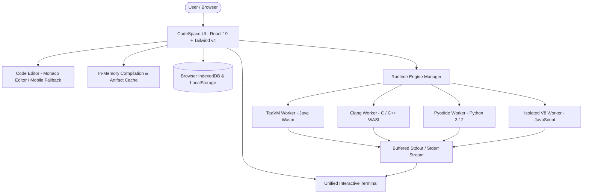

# ⚡ CodeSpace — Serverless In-Browser Online Compiler & IDE

<div align="center">

[](https://opensource.org/licenses/MIT)
[](https://www.typescriptlang.org/)
[](https://react.dev/)
[](https://tailwindcss.com/)
[](https://webassembly.org/)
[](https://github.com/DEVASANJAY001/online-compiler.git)

**A high-performance, 100% client-side online compiler and development environment supporting C, C++, Java, Python, and JavaScript executing locally in the browser via WebAssembly.**

[Features](#-key-features) • [Language Toolchains](#-supported-languages--toolchains) • [Architecture](#-architecture) • [Getting Started](#-getting-started) • [Deployment](#-deployment)

</div>

---

## 🌟 Overview

**CodeSpace** is an in-browser online compiler and IDE designed for zero-latency, private, and serverless code execution. Unlike traditional online compilers (e.g. Judge0, Piston, OneCompiler) that send code to remote cloud servers or Docker containers, CodeSpace runs **100% in your browser** using WebAssembly, Web Workers, and local virtual filesystems.

- **Zero Backend Required**: No Node.js execution server, no Docker containers, and no external API limits.
- **Instant Repeat Runs**: Built-in in-memory compilation caching delivers sub-50ms repeat executions.
- **Private & Secure**: Your code and stdin inputs never leave your device.
- **Offline Capable**: Cached WebAssembly toolchains continue functioning even without an active internet connection.

---

## 🚀 Key Features

### 🖥️ Unified Interactive Terminal with Inline Stdin
- **Single Terminal Screen**: Output (`stdout`, `stderr`) and user input (`stdin`) live in a unified console stream.
- **Real-Time Input Detection**: Automatically prompts user when a program requests input (`Scanner`, `cin`, `scanf`, `input()`).
- **Inline Cursor**: Interactive blinking line cursor directly within the output flow. Press Enter to submit inputs sequentially.
- **Precise Metrics**: Execution time, compile time, peak memory usage, and exit codes displayed beside timestamps.

### 🎨 Clean Light & Dark Themes (Browser Personalized)
- **Default White Theme**: Clean, modern, distraction-free light theme enabled by default.
- **Personalized Dark Mode**: Switch to dark mode anytime via the header toggle or Preferences modal.
- **Browser Persistence**: Your theme preference is automatically remembered and synced via `localStorage` and `IndexedDB`.
- **Full UI Integration**: Header, sidebar, tabs, Monaco editor, terminal, modals, and footer adapt seamlessly.

### 📱 Fully Mobile Optimized & Responsive Layout
- **Smartphone & Tablet Ready**: Optimized alignment and touch targets for screens as small as 320px up to 4K monitors.
- **Responsive Workspace**: Automatic full-width editing and terminal view on mobile, with a responsive bottom console.
- **Mobile Action Menu**: Quick access to Formatting, Code Reset, Templates, File Downloads, and Settings via a mobile-friendly menu.
- **Smart Keyboard Support**: Mobile textarea code editor includes Tab key indentation and auto-formatting shortcuts.

### 📁 Multi-File Project Explorer & Tab Renaming
- **Multiple Files Support**: Add multiple source files and headers (`.h`, `.hpp`, `.c`, `.cpp`, `.java`, `.py`, `.js`).
- **Batch File Creation**: Create multiple files at once by separating names with commas (`Helper.java, MathUtil.java`).
- **Inline File Renaming**: Double-click any tab or click the pencil icon to rename files inline.
- **Starter Templates**: Load pre-built single-file and multi-file starter templates for every language.

### 🏷️ Authentic Language Brand Logos
- Real, transparent vector brand marks for **Java** (Oracle coffee cup), **C** (ISO hexagon), **C++** (ISO hexagon with `++`), **Python** (PSF blue/yellow snakes), and **JavaScript** (official JS badge).

### ⚡ Split View Modes
- **Friendly Mode (Default)**: Top full-width code editor with bottom interactive console (resizable divider).
- **PRO Mode**: Side-by-side split screen IDE layout with simultaneous editing and output view.

---

## 📊 Supported Languages & Toolchains

| Language | Engine / Toolchain | Execution Environment | Compiler Diagnostics | Multi-File | Stdin |
| :--- | :--- | :--- | :--- | :--- | :--- |
| **Java** | TeaVM 0.13.1 + OpenJDK 17 | WebAssembly GC / WASI | ✅ javac-style error diagnostics | ✅ Multi-Class / Modules | ✅ Interactive Stdin |
| **C** | Clang 22.0.0 (Wasm) | WASI Isolated Sandbox | ✅ Full Clang error & warning markers | ✅ Header `.h` & `.c` files | ✅ Interactive Stdin |
| **C++** | Clang++ 22.0.0 (C++20) | WASI Isolated Sandbox | ✅ Full Clang++ C++20 diagnostics | ✅ Header `.hpp` & `.cpp` files | ✅ Interactive Stdin |
| **Python** | CPython 3.12 (Pyodide) | Dedicated Web Worker | ✅ Tracebacks & SyntaxErrors | ✅ Python Modules in VFS | ✅ Interactive Stdin |
| **JavaScript** | V8 / Modern ECMAScript | Dedicated Web Worker | ✅ Stack traces & console capture | ✅ Virtual Files | ✅ Preloaded Stdin |

---

## 🏗️ Architecture



---

## 🛠️ Getting Started

### Prerequisites
- [Node.js](https://nodejs.org/) `>= 20.x`
- [npm](https://www.npmjs.com/) `>= 10.x`

### 1. Clone the Repository
```bash
git clone https://github.com/DEVASANJAY001/online-compiler.git
cd online-compiler
```

### 2. Install Dependencies
```bash
npm install
```

### 3. Start Development Server
```bash
npm run dev
```
Open [http://localhost:5173](http://localhost:5173) in your browser.

### 4. Run Unit Tests
```bash
npm test
```

### 5. Build for Production
```bash
npm run build
```
The optimized production bundle will be generated in `dist/`.

---

## 🌐 Deployment

CodeSpace is completely static with **zero server dependencies**. You can deploy it to any static web host:

### GitHub Pages
1. Build the production bundle:
   ```bash
   npm run build
   ```
2. Deploy the `dist` folder to GitHub Pages via GitHub Actions or the `gh-pages` branch.

### Cloudflare Pages / Vercel / Netlify
- **Build command**: `npm run build`
- **Output directory**: `dist`
- **Required Security Headers** (already configured in `public/_headers`):
  ```http
  Cross-Origin-Opener-Policy: same-origin
  Cross-Origin-Embedder-Policy: credentialless
  ```

---

## ⌨️ Keyboard Shortcuts

| Shortcut | Action |
| :--- | :--- |
| `Ctrl + Enter` / `Cmd + Enter` | Run code |
| `Ctrl + S` / `Cmd + S` | Save active file |
| `Shift + Alt + F` | Auto-format code |
| `Double Click Tab` | Rename file |

---

## 📄 License

This project is licensed under the [MIT License](LICENSE).

WebAssembly toolchains and runtimes are licensed under their respective open-source licenses:
- LLVM / Clang: Apache 2.0 with LLVM Exception
- TeaVM: Apache 2.0 License
- OpenJDK: GPLv2 with Classpath Exception
- Pyodide / CPython: Python Software Foundation License
